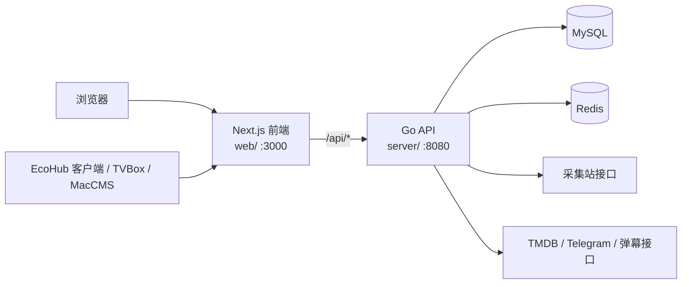

<div align="center">


# EcoHub

[](https://github.com/fe-spark/EcoHub/releases)
[](https://go.dev/)
[](https://nextjs.org/)
[](https://www.mysql.com/)
[](https://redis.io/)
[](https://github.com/fe-spark/EcoHub/pkgs/container/ecohub)
[](./LICENSE)

**自托管影视聚合系统：从采集站汇集影视数据，提供观影网站、管理后台和多种客户端订阅接口。**

中文 | [English](./docs/README_EN.md)

[在线演示](https://eco.fe-spark.cn) · [管理后台演示](https://eco.fe-spark.cn/manage) · [部署指南](./docs/README-Deploy.md) · [常见问题](./docs/README-FAQ.md) · [版本说明](./docs/RELEASE.md) · [交流群组](https://t.me/ecohub_club)

</div>

> [!WARNING]
> v3 与 v2 的数据库不兼容，且不提供数据迁移。请勿在旧的 `./data/mysql` 上直接拉取新镜像，也请勿使用 v2 后台的「立即升级」。操作步骤见 [从 v2 升级到 v3](./docs/v2-to-v3.md)。

## 简介

EcoHub 是一套自托管的影视聚合系统。管理员在后台配置一个或多个采集站，EcoHub 定时拉取影片数据并统一入库，对外提供观影网站、管理后台，以及供 EcoHub 客户端、TVBox / 影视仓和 MacCMS 使用的订阅地址。

典型流程：安装后在后台启用采集站并执行一次全量采集，前台即可搜索、筛选和播放；将订阅地址填入 TVBox 后，可在电视端观看。

EcoHub 面向希望在自有服务器上搭建私有影视站点的个人和小型团队。系统以单个 Docker 镜像发布，配合 MySQL 和 Redis 即可运行。

EcoHub 不提供、不存储任何影视文件，片源来自使用者自行配置的采集接口。

## 主要功能

**采集**

- 支持多个采集站，兼容 JSON 和 XML 两种采集接口格式；各采集站独立建档，单站异常不影响其他站点。
- 支持全量采集和增量采集，失败页可重试；每次采集的批次、状态和入库明细均有记录。
- 计划任务：默认包含每小时增量采集，以及片库清理、日志清理、采集记录清理三项维护任务；维护任务与采集任务冲突时按固定规则执行。

**片库与检索**

- 主站机制：已启用采集站中排序最前的一个作为前台主站；播放页按匹配键附加其他采集站的同一部影片的线路。
- 内存倒排索引，支持分词、全拼和简拼搜索；分类规则、分类合并和隐藏按采集站配置。
- TMDB 刮削：为影片补充海报、简介、评分等信息。

**观影网站**

- 首页轮播、分类筛选、搜索、每日更新和观看历史。
- 基于 Artplayer 和 Hls.js 的播放器，支持多线路、播放进度记忆和按显示宽度自适应的布局。
- 弹幕：支持本站用户发送弹幕，并可从弹弹play 官方接口或自建 danmu-api 获取全网弹幕。
- 私有化访问：开启后前台和订阅接口需要登录或订阅密钥。

**订阅接口**

| 地址 | 用途 |
| --- | --- |
| `/api/provide/app` | EcoHub 客户端 |
| `/api/provide/tvbox` | TVBox / 影视仓 |
| `/api/provide/vod` | MacCMS |

**管理后台**

- 采集中心、采集记录、计划任务、影片列表、首页轮播（含一键排片）、分类管理与分类规则。
- 素材中心、数据分析、账号管理（超级用户、普通用户、访客三种角色）、运行日志。
- 网络代理：采集、TMDB 刮削、Telegram 通知、版本检查和弹幕抓取可按模块分别配置是否经由代理访问。
- 通知推送：通过 Telegram 机器人推送采集汇总、采集站失败、计划任务失败和主站变更等通知。
- 数据安全：站点配置、采集站、首页轮播、分类规则、网络代理、TMDB、数据分析和通知配置支持导出备份，并可按模块导入。
- 在线升级：后台可拉取最新镜像并重启。

**客户端**

客户端为独立仓库，以 git submodule 形式包含在本仓库中：

- [EcoHub for Android](https://github.com/fe-spark/EcoHub-for-Android)（`app-for-android/`）
- [EcoHub for OHOS](https://github.com/fe-spark/EcoHub-for-OHOS)（`app-for-ohos/`）

## 技术架构

| 组件 | 技术 | 目录 |
| --- | --- | --- |
| 后端 API | Go 1.27、Gin、GORM | `server/` |
| 前端 | Next.js 16、React 19、TypeScript、Ant Design 6 | `web/` |
| 数据库 | MySQL 8 | — |
| 缓存 | Redis 7 | — |
| 发布 | Docker 镜像 `ghcr.io/fe-spark/ecohub`（`linux/amd64`、`linux/arm64`） | `Dockerfile`、`deploy/release/` |

发布镜像为 All-in-One 形式：同一容器内由 supervisord 运行 Go API（端口 `8080`）和 Next.js（端口 `3000`），Next.js 将 `/api/*` 转发给 Go API。



## 快速开始

环境要求：Docker 20+ 和 Docker Compose，建议 2 核 CPU、2 GB 内存及以上。执行以下命令安装：

```bash
curl -fsSL https://raw.githubusercontent.com/fe-spark/EcoHub/main/scripts/install-release.sh \
  | ECOHUB_IMAGE=ghcr.io/fe-spark/ecohub:v3.0.3 sh
```

安装完成后，终端输出前台、后台地址、初始账号和三条订阅地址，默认 Web 端口为 `3000`。数据位于 `~/ecohub`，之后通过 `ecohub` 命令管理（如 `ecohub status`、`ecohub update`）。在后台「采集中心」执行一次全量采集后，影片随采集进度陆续出现在前台。

密码设置、`ecohub` 命令、1Panel、手动 `docker run`、反向代理和环境变量，见 [部署指南](./docs/README-Deploy.md)。

## 文档

| 文档 | 内容 |
| --- | --- |
| [部署指南](./docs/README-Deploy.md) | 安装、`ecohub` 命令、密码、端口、1Panel、反向代理、环境变量 |
| [从 v2 升级到 v3](./docs/v2-to-v3.md) | 删除旧容器、使用空库重装、全量采集 |
| [常见问题](./docs/README-FAQ.md) | 空站、主站、采集、缓存、网络代理、弹幕、登录、私有化访问 |
| [计划任务运行冲突](./docs/cron-task-conflict.md) | 采集任务与维护任务同时触发时的执行顺序 |
| [开发指南](./docs/README-Dev.md) | 本地开发环境与开发编排 |
| [服务端说明](./server/README.md) | Go 后端的启动、环境变量、接口、目录结构 |
| [前端说明](./web/README.md) | Next.js 前端的启动、`API_URL`、鉴权、目录结构 |
| [版本说明](./docs/RELEASE.md) | 当前版本的变更内容 |
| [文档索引](./docs/README.md) | 全部文档，含英文版 |

## 目录结构

```text
EcoHub/
├── server/              # Go 后端 API
├── web/                 # Next.js 前端（前台与管理后台）
├── app-for-android/     # Android 客户端（git submodule）
├── app-for-ohos/        # OHOS 客户端（git submodule）
├── deploy/release/      # 发布编排 compose.yml
├── scripts/             # 安装脚本 install-release.sh（ecohub 命令）
├── docs/                # 项目文档
├── .github/workflows/   # GitHub Release 与 Docker 镜像发布流程
├── Dockerfile           # All-in-One 发布镜像
├── docker-compose.yml   # 本地开发编排
└── supervisord.conf     # 镜像内进程管理配置
```

## 参与贡献

本项目由作者业余维护，更新频率有限，欢迎提交 [Issues](https://github.com/fe-spark/EcoHub/issues) 和 [Pull Requests](https://github.com/fe-spark/EcoHub/pulls)。文档修改请遵循 [文档写作规范](./docs/STYLE.md)。

### 本地开发

环境要求：Go 1.27+、Node.js 20.9+、MySQL 8、Redis 7。开发编排和启动方式见 [开发指南](./docs/README-Dev.md)，后端和前端的详细说明见 [服务端说明](./server/README.md) 和 [前端说明](./web/README.md)。

## 许可证

本项目基于 [PolyForm Noncommercial License 1.0.0](./LICENSE) 发布，仅允许非商业用途。

使用 EcoHub 时请遵守当地法律法规及采集站的使用条款。
