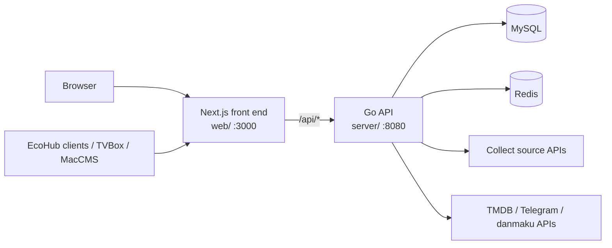

<div align="center">


# EcoHub

[](https://github.com/fe-spark/EcoHub/releases)
[](https://go.dev/)
[](https://nextjs.org/)
[](https://www.mysql.com/)
[](https://redis.io/)
[](https://github.com/fe-spark/EcoHub/pkgs/container/ecohub)
[](../LICENSE)

**A self-hosted media aggregation system that collects film data from collect sources and serves a viewing site, an admin panel, and subscription endpoints for multiple clients.**

[中文](../README.md) | English

[Demo](https://eco.fe-spark.cn) · [Admin demo](https://eco.fe-spark.cn/manage) · [Deploy guide](./README-Deploy_EN.md) · [FAQ](./README-FAQ_EN.md) · [Release notes](./RELEASE_EN.md) · [Telegram](https://t.me/ecohub_club)

</div>

> [!WARNING]
> The v3 database is incompatible with v2, and no data migration is provided. Do not pull the new image onto an existing `./data/mysql`, and do not use "立即升级" (Upgrade now) in the v2 admin panel. For the procedure, see [Upgrade from v2 to v3](./v2-to-v3_EN.md).

## Introduction

EcoHub is a self-hosted media aggregation system. Administrators configure one or more collect sources in the admin panel; EcoHub pulls film data from them on a schedule into a single library and serves a viewing site, an admin panel, and subscription URLs for the EcoHub clients, TVBox / 影视仓, and MacCMS.

Typical workflow: after installation, enable collect sources in the admin panel and run one full collect. The site then supports search, filtering, and playback. Adding a subscription URL to TVBox enables viewing on a TV.

EcoHub is intended for individuals and small teams who want to run a private media site on their own server. It is released as a single Docker image and runs with MySQL and Redis.

EcoHub does not provide or store any media files. All content comes from the collect APIs configured by the operator.

## Features

**Collect**

- Multiple collect sources, with support for both JSON and XML collect APIs. Each source is stored separately, so a failure in one source does not affect the others.
- Full collect and incremental collect, with retry for failed pages. Each collect run records its batch, status, and stored items.
- Scheduled tasks: an hourly incremental collect by default, plus three maintenance tasks (library cleanup, log cleanup, and collect record cleanup). Conflicts between maintenance tasks and collect tasks are resolved by fixed rules.

**Library and search**

- Main source: the first enabled collect source in the list serves as the main source for the site. The play page appends play lines for the same film from other collect sources, matched by match key.
- In-memory inverted index with support for word segmentation, full pinyin, and pinyin initials. Category rules, category merging, and hiding are configured per collect source.
- TMDB scraping: adds posters, overviews, ratings, and other metadata to films.

**Viewing site**

- Home page banners, category filters, search, daily updates, and watch history.
- A player based on Artplayer and Hls.js, with multiple play lines, playback position memory, and a layout that adapts to the displayed width.
- Danmaku: site users can send danmaku, and danmaku can also be fetched from the official dandanplay API or a self-hosted danmu-api.
- Private access: when enabled, the site and the subscription endpoints require login or a subscription key.

**Subscription endpoints**

| URL | Purpose |
| --- | --- |
| `/api/provide/app` | EcoHub clients |
| `/api/provide/tvbox` | TVBox / 影视仓 |
| `/api/provide/vod` | MacCMS |

**Admin panel**

- Collect center, collect records, scheduled tasks, film list, home page banners (with quick scheduling), categories, and category rules.
- Asset center, analytics, account management (three roles: super user, normal user, and visitor), and runtime logs.
- Network proxy: collect, TMDB scraping, Telegram notifications, version check, and danmaku fetching can each be configured to use a proxy.
- Notifications: a Telegram bot sends collect summaries, collect source failures, scheduled task failures, and main source changes.
- Data security: site settings, collect sources, banners, category rules, network proxy, TMDB, analytics, and notification settings can be exported as a backup and imported per module.
- Online upgrade: the admin panel can pull the latest image and restart.

**Clients**

The clients are separate repositories included in this repository as git submodules:

- [EcoHub for Android](https://github.com/fe-spark/EcoHub-for-Android) (`app-for-android/`)
- [EcoHub for OHOS](https://github.com/fe-spark/EcoHub-for-OHOS) (`app-for-ohos/`)

## Architecture

| Component | Technology | Directory |
| --- | --- | --- |
| Backend API | Go 1.27, Gin, GORM | `server/` |
| Front end | Next.js 16, React 19, TypeScript, Ant Design 6 | `web/` |
| Database | MySQL 8 | — |
| Cache | Redis 7 | — |
| Release | Docker image `ghcr.io/fe-spark/ecohub` (`linux/amd64`, `linux/arm64`) | `Dockerfile`, `deploy/release/` |

The release image is All-in-One: supervisord runs the Go API (port `8080`) and Next.js (port `3000`) in the same container, and Next.js forwards `/api/*` to the Go API.



## Quick start

Requirements: Docker 20+ and Docker Compose; 2 CPU cores and 2 GB of memory or more are recommended. Run the following command to install:

```bash
curl -fsSL https://raw.githubusercontent.com/fe-spark/EcoHub/main/scripts/install-release.sh \
  | ECOHUB_IMAGE=ghcr.io/fe-spark/ecohub:v3.0.4 sh
```

After installation, the terminal prints the site and admin URLs, the initial account, and the three subscription URLs. The default web port is `3000`. Data is stored in `~/ecohub` and is managed with the `ecohub` command (for example, `ecohub status` and `ecohub update`). After a full collect is run from "采集中心" (Collect center) in the admin panel, films appear on the site as the collect progresses.

For passwords, the `ecohub` command, 1Panel, manual `docker run`, reverse proxies, and environment variables, see the [Deploy guide](./README-Deploy_EN.md).

## Documentation

| Document | Contents |
| --- | --- |
| [Deploy guide](./README-Deploy_EN.md) | Installation, the `ecohub` command, passwords, ports, 1Panel, reverse proxies, environment variables |
| [Upgrade from v2 to v3](./v2-to-v3_EN.md) | Removing the old containers, reinstalling with an empty database, running a full collect |
| [FAQ](./README-FAQ_EN.md) | Empty site, main source, collect, cache, network proxy, danmaku, login, private access |
| [Scheduled task conflicts](./cron-task-conflict_EN.md) | Execution order when collect and maintenance tasks are triggered at the same time |
| [Development guide](./README-Dev_EN.md) | Local development environment and the development compose file |
| [Server](../server/README_EN.md) | Go backend: startup, environment variables, APIs, directory layout |
| [Web](../web/README_EN.md) | Next.js front end: startup, `API_URL`, authentication, directory layout |
| [Release notes](./RELEASE_EN.md) | Changes in the current release |
| [Documentation index](./README.md) | All documents, including English versions |

## Directory layout

```text
EcoHub/
├── server/              # Go backend API
├── web/                 # Next.js front end (site and admin panel)
├── app-for-android/     # Android client (git submodule)
├── app-for-ohos/        # OHOS client (git submodule)
├── deploy/release/      # Release compose file compose.yml
├── scripts/             # Install script install-release.sh (ecohub command)
├── docs/                # Project documentation
├── .github/workflows/   # GitHub Release and Docker image workflows
├── Dockerfile           # All-in-One release image
├── docker-compose.yml   # Local development compose file
└── supervisord.conf     # Process manager configuration inside the image
```

## Contributing

This project is maintained by the author in spare time, and updates are infrequent. [Issues](https://github.com/fe-spark/EcoHub/issues) and [pull requests](https://github.com/fe-spark/EcoHub/pulls) are welcome. Documentation changes must follow the [documentation style guide](./STYLE.md) (Chinese).

### Local development

Requirements: Go 1.27+, Node.js 20.9+, MySQL 8, Redis 7. For the development compose file and startup modes, see the [Development guide](./README-Dev_EN.md). For details on the backend and the front end, see [Server](../server/README_EN.md) and [Web](../web/README_EN.md).

## License

This project is released under the [PolyForm Noncommercial License 1.0.0](../LICENSE), which permits noncommercial use only.

When using EcoHub, comply with local laws and regulations and with the terms of use of the collect sources.
