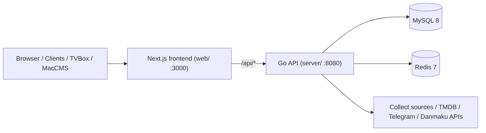

<div align="center">


# EcoHub

[](https://github.com/fe-spark/EcoHub/releases)
[](https://go.dev/)
[](https://nextjs.org/)
[](https://www.mysql.com/)
[](https://redis.io/)
[](https://github.com/fe-spark/EcoHub/pkgs/container/ecohub)
[](../LICENSE)

**Self-hosted film aggregation system: collects film metadata from collect sources and provides a viewing site, an admin panel, and subscription endpoints.**

[中文](../README.md) | English

[Demo](https://eco.fe-spark.cn) · [Admin demo](https://eco.fe-spark.cn/manage) · [Deploy guide](./README-Deploy_EN.md) · [FAQ](./README-FAQ_EN.md) · [Release notes](./RELEASE_EN.md) · [Telegram](https://t.me/ecohub_club)

</div>

> [!WARNING]
> v3 cannot read a v2 database, and there is no migration. Do not pull the new image on top of an old `./data/mysql`, and do not click "立即升级" (upgrade now) in the v2 admin. Steps: [v2 to v3](./v2-to-v3_EN.md).

## Overview

EcoHub is a self-hosted film aggregation system for individuals and small teams. After an administrator configures collect sources in the admin panel, EcoHub periodically fetches film metadata into the database and exposes a viewing site, an admin panel, and subscription endpoints for clients.

The application ships as a single All-in-One Docker image and runs alongside MySQL 8 and Redis 7.

EcoHub neither provides nor stores any media files; all sources come from collect APIs configured by the deployer.

## Main features

- **Multi-source collection and scheduling**: supports JSON and XML collect APIs, full and incremental collects, failed-page retries, and collect batch records; includes an hourly incremental collect and three maintenance tasks (library, log, and collect record cleanup).
- **Main source and in-memory search**: the global main source is explicitly selected in the admin panel (reordering sources does not change the main source); the in-memory inverted index stays resident for the current main source with word segmentation, full pinyin, and pinyin initials; supports category rules and TMDB metadata scraping.
- **Viewing site and player**: home page banners, category filters, daily updates, watch history, and private access control; Artplayer and Hls.js player with multi-line switching, playback position memory, and danmaku support.
- **Subscription endpoints**: provides `/api/provide/app` (EcoHub clients), `/api/provide/tvbox` (TVBox / 影视仓), and `/api/provide/vod` (MacCMS); the play page aggregates play lines from other enabled sources by match key.
- **Admin panel and operations**: collect center, library and banner management, asset center, analytics, multi-role accounts, per-module network proxy, Telegram notifications, configuration export/import, and online upgrade.
- **Native clients**: separate repositories linked as git submodules: [EcoHub for Android](https://github.com/fe-spark/EcoHub-for-Android) (`app-for-android/`) and [EcoHub for OHOS](https://github.com/fe-spark/EcoHub-for-OHOS) (`app-for-ohos/`).

For behavioral details, see the [FAQ](./README-FAQ_EN.md).

## Architecture

| Component | Stack | Directory |
| --- | --- | --- |
| Backend API | Go 1.27, Gin, GORM | `server/` |
| Frontend | Next.js 16, React 19, TypeScript, Ant Design 6 | `web/` |
| Database and cache | MySQL 8, Redis 7 | — |
| Release image | `ghcr.io/fe-spark/ecohub` (`linux/amd64`, `linux/arm64`) | `Dockerfile`, `deploy/release/` |



## Quick start

Requirements: Docker 20+ and Docker Compose, with 2 CPU cores and 2 GB RAM or more recommended. Run:

```bash
curl -fsSL https://raw.githubusercontent.com/fe-spark/EcoHub/main/scripts/install-release.sh \
  | ECOHUB_IMAGE=ghcr.io/fe-spark/ecohub:v3.1.0 sh
```

After installation, the terminal prints the site and admin URLs, initial credentials, and subscription URLs. The default web port is `3000`, the install directory is `~/ecohub`, and daily management uses the `ecohub` command. For passwords, ports, 1Panel, manual deployment, reverse proxies, and environment variables, see the [Deploy guide](./README-Deploy_EN.md).

## Recommendations

| Kind | Provider | Link |
| --- | --- | --- |
| Server | CloudCone (hosts the demo; unthrottled disk I/O) | [Visit](https://app.cloudcone.com/?ref=14393) |
| Network | LiangXinYun, from ¥2/mo | [Register](https://xn--9kqz23b19z.com/#/register?code=xAmvfdic) |
| Network | PeiQian, from ¥1.5/mo | [Register](https://xn--mes358aby2apfg.com/register?code=FA4xlzHD&cover=sfw) |
| Network | DOVE | [Register](https://dovee.cc/a.php?asbcbO1PCgTx2JM66) |

## Documentation

| Document | Contents |
| --- | --- |
| [Deploy guide](./README-Deploy_EN.md) | Install, `ecohub` CLI, passwords, ports, 1Panel, reverse proxy, environment variables |
| [v2 to v3](./v2-to-v3_EN.md) | Removing old containers, fresh install with an empty database, full collect |
| [FAQ](./README-FAQ_EN.md) | Empty site, main source, collect, cache, network proxy, danmaku, login, private access |
| [Scheduled task conflicts](./cron-task-conflict_EN.md) | Execution order when collect and maintenance tasks are triggered together |
| [Dev guide](./README-Dev_EN.md) | Local development environment and development compose |
| [Server guide](../server/README_EN.md) | Go backend startup, environment variables, endpoints, directory layout |
| [Web guide](../web/README_EN.md) | Next.js frontend startup, `API_URL`, authentication, directory layout |
| [Release notes](./RELEASE_EN.md) | Changes in the current and previous releases |
| [Docs index](./README.md) | Complete index of Chinese and English documents |

## Directory layout

```text
EcoHub/
├── server/              # Go backend API
├── web/                 # Next.js frontend (viewing site and admin panel)
├── app-for-android/     # Android client (git submodule)
├── app-for-ohos/        # OHOS client (git submodule)
├── deploy/release/      # Release compose file (compose.yml)
├── scripts/             # Install script install-release.sh (ecohub CLI)
├── docs/                # Project documentation
├── .github/workflows/   # GitHub Release and Docker image workflows
├── Dockerfile           # All-in-One release image
├── docker-compose.yml   # Local development compose
└── supervisord.conf     # Process manager config inside the release image
```

## Contributing

This project is maintained in spare time with limited update frequency. [Issues](https://github.com/fe-spark/EcoHub/issues) and [Pull Requests](https://github.com/fe-spark/EcoHub/pulls) are welcome. Documentation changes should follow the [Style guide](./STYLE.md) (Chinese).

### Local development

Requirements: Go 1.27+, Node.js 20.9+, MySQL 8, and Redis 7. See the [Dev guide](./README-Dev_EN.md) for setup and compose usage, and the [Server guide](../server/README_EN.md) and [Web guide](../web/README_EN.md) for module details.

## License

This project is licensed under the [PolyForm Noncommercial License 1.0.0](../LICENSE) for noncommercial use only.

Comply with local laws and the terms of use of each collect source when using EcoHub.
