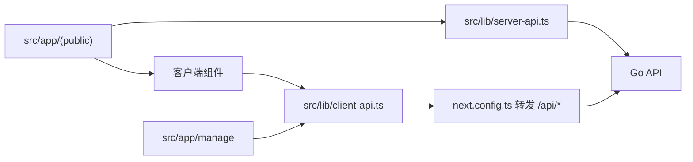

# 前端说明

中文 | [English](./README_EN.md)

`web/` 为 EcoHub 的 Next.js 前端，包含前台、登录页和管理后台。

技术栈：Next.js 16、React 19、TypeScript、Ant Design 6、Axios、Less、Artplayer、Hls.js。

## 请求转发

浏览器只请求本站的 `/api/*`，由 Next 按 `API_URL` 转发给 Go 后端。服务端渲染时，`src/lib/server-api.ts` 直接通过 `API_URL` 请求后端。



示例：`API_URL=http://127.0.0.1:8080` 时，浏览器请求 `http://127.0.0.1:3000/api/home`，Next 转发到 `http://127.0.0.1:8080/api/home`。

## 本地启动

环境要求：Node.js 20.9+，且 Go 后端已启动（见 [服务端说明](../server/README.md)）。

```bash
cd web
cp .env.example .env.local
npm install
npm run dev
```

`.env.example` 内容如下：

```env
PORT=3000
API_URL=http://127.0.0.1:8080
```

前台地址为 `http://127.0.0.1:3000`，登录页为 `/login`，后台为 `/manage`。

### 在容器中运行前端

仓库根目录的开发编排 `docker-compose.yml` 包含 `web` 服务，使用 `web/Dockerfile` 从源码构建，容器名为 `Eco-web`。该编排仅用于本地开发，与发布编排的区别见 [开发指南](../docs/README-Dev.md#开发编排)。

```bash
docker compose up -d mysql redis
docker compose up -d --build web
```

- 在仓库根目录执行。`web` 依赖 `server` 的健康检查，因此会同时构建并启动 `server`。
- 构建和运行时的 `API_URL` 均为 `http://server:8080`，即同一编排中的 `server` 服务，不读取 `web/.env.local`。
- 前台映射到本机 `3000`（`WEB_PORT`）。

## 环境变量

| 变量 | 默认值 | 必填 | 说明 |
| --- | --- | --- | --- |
| `PORT` | `3000` | 否 | 本地开发端口 |
| `API_URL` | 无 | 是 | Go 后端地址。未设置时构建和启动均会报错 |

`API_URL` 说明：

- 可以包含或省略 `/api` 及结尾的 `/`，`http://127.0.0.1:8080` 与 `http://127.0.0.1:8080/api/` 效果相同。
- 后端位于其他机器时，填写该机器的地址。
- 修改后须重启 Next。`API_URL` 在构建时写入产物，生产构建修改后须重新执行 `npm run build`。
- 在容器内，`127.0.0.1` 指向容器自身。
- 发布镜像在构建时已固定为 `http://127.0.0.1:8080`，部署时无需设置。

## 鉴权

- 登录状态保存在后端下发的 HttpOnly cookie `ecohub_auth_token` 中。
- 访问 `/manage` 时进行两道检查：`src/proxy.ts` 先检查 cookie 是否存在，不存在时跳转到 `/login`；`src/app/manage/layout.tsx` 再请求 `/api/manage/user/info`，后端校验失败时同样跳转到 `/login`。
- JWT、Redis 中的 token 和写权限均由后端判断。`src/lib/client-api.ts` 收到 `401` 时跳转到 `/login`，收到 `403` 时提示无权限。

## 目录结构

```text
web/
├── src/app/(public)/    # 前台
├── src/app/login/       # 登录页
├── src/app/manage/      # 管理后台
├── src/components/      # 公共组件
├── src/lib/             # server-api.ts、client-api.ts、api-base.ts 等
├── src/proxy.ts         # /manage 的 cookie 检查
├── patches/             # npm install 后由 patch-package 应用的补丁
└── next.config.ts       # /api/* 转发、standalone 输出
```

## 常用命令

| 命令 | 说明 |
| --- | --- |
| `npm run dev` | 开发模式 |
| `npm run build` | 生产构建，输出 standalone |
| `npm run start` | 运行生产构建 |
| `npm run lint` | ESLint 检查 |

## 相关文档

[总览](../README.md) · [服务端说明](../server/README.md) · [部署指南](../docs/README-Deploy.md) · [常见问题](../docs/README-FAQ.md)
