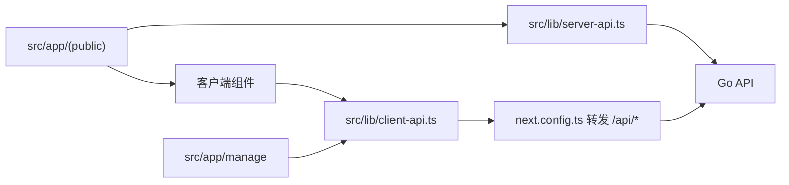

# 前端说明

本文只有中文版。

`web/` 是 EcoHub 的 Next.js 前端：前台、登录页和管理后台。

技术栈：Next.js 16、React 19、TypeScript、Ant Design 6、Axios、Less、Artplayer、Hls.js。

## 请求怎么到后端

浏览器只请求本站的 `/api/*`，Next 按 `API_URL` 把它转发给 Go 后端。服务端渲染时，`src/lib/server-api.ts` 直接用 `API_URL` 请求后端。



举例：`API_URL=http://127.0.0.1:8080` 时，浏览器请求 `http://127.0.0.1:3000/api/home`，Next 转发到 `http://127.0.0.1:8080/api/home`。

## 本地启动

需要 Node.js 20.9+，并且 Go 后端已经在跑（见 [服务端说明](../server/README.md)）。

```bash
cd web
cp .env.example .env.local
npm install
npm run dev
```

`.env.example` 的内容：

```env
PORT=3000
API_URL=http://127.0.0.1:8080
```

前台 `http://127.0.0.1:3000`，登录页 `/login`，后台 `/manage`。

## 环境变量

| 变量 | 默认值 | 必填 | 说明 |
| --- | --- | --- | --- |
| `PORT` | `3000` | 否 | 本地开发端口 |
| `API_URL` | 无 | 是 | Go 后端地址。没设置时构建和启动都会报错 |

关于 `API_URL`：

- 带不带 `/api`、带不带结尾的 `/` 都可以，`http://127.0.0.1:8080` 和 `http://127.0.0.1:8080/api/` 效果一样。
- 后端在别的机器上，就写那台机器的地址。
- 改完要重启 Next。`API_URL` 在构建时写进产物，生产构建改了要重新 `npm run build`。
- 在容器里，`127.0.0.1` 指的是容器自己。
- 发布镜像构建时已经固定为 `http://127.0.0.1:8080`，部署时不用设置。

## 鉴权

- 登录态是后端下发的 HttpOnly cookie `ecohub_auth_token`。
- 访问 `/manage` 时有两道检查：`src/proxy.ts` 先看 cookie 在不在，没有就跳 `/login`；`src/app/manage/layout.tsx` 再请求 `/api/manage/user/info`，后端校验不过也跳 `/login`。
- JWT、Redis 里的 token 和写权限都由后端判断。`src/lib/client-api.ts` 收到 `401` 跳 `/login`，收到 `403` 提示无权限。

## 目录

```text
web/
├── src/app/(public)/    # 前台
├── src/app/login/       # 登录页
├── src/app/manage/      # 管理后台
├── src/components/      # 公共组件
├── src/lib/             # server-api.ts、client-api.ts、api-base.ts 等
├── src/proxy.ts         # /manage 的 cookie 检查
├── patches/             # npm install 后由 patch-package 打的补丁
└── next.config.ts       # /api/* 转发、standalone 输出
```

## 命令

| 命令 | 做什么 |
| --- | --- |
| `npm run dev` | 开发模式 |
| `npm run build` | 生产构建，输出 standalone |
| `npm run start` | 运行生产构建 |
| `npm run lint` | ESLint 检查 |

## 相关

[总览](../README.md) · [服务端说明](../server/README.md) · [部署指南](../docs/README-Deploy.md) · [常见问题](../docs/README-FAQ.md)
