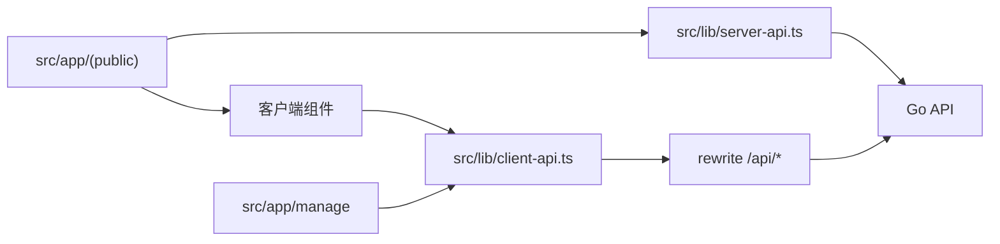

# Web

`web/` 是 Next.js 前端：前台、登录页和管理后台。

技术栈：Next.js 16、React 19、TypeScript、Ant Design 6、Axios、Less、Artplayer / Hls.js。

浏览器请求本站 `/api/*`，Next 按 `API_URL` 转发到 Go。发布镜像不读 `API_URL`。



## 本地启动

```bash
cd web
cp .env.example .env.local
npm install
npm run dev
```

```env
PORT=3000
API_URL=http://127.0.0.1:8080
```

前台 `http://127.0.0.1:3000`，登录 `/login`，后台 `/manage`。`API_URL` 带不带 `/api` 都可以。后端在别的机器上时写成那台机器的地址。改完要重启 Next。容器里的 `127.0.0.1` 是 web 容器自己。

| 变量 | 必填 | 说明 |
| --- | --- | --- |
| `PORT` | 否 | 默认 `3000` |
| `API_URL` | 本地开发是 | Go 的地址 |

## 鉴权

- 登录态是后端下发的 HttpOnly cookie `ecohub_auth_token`。
- `/manage` 只在 `src/proxy.ts` 检查 cookie 在不在。
- JWT、Redis token 和写权限都在后端。前端收到 `401` 去 `/login`，收到 `403` 提示无权限。

## 目录

```text
web/
├── src/app/(public)/    # 前台
├── src/app/login/
├── src/app/manage/
├── src/components/
├── src/lib/             # server-api.ts client-api.ts
├── src/proxy.ts
└── next.config.ts       # /api/* rewrite
```

## 命令

```bash
npm run dev
npm run build
npm run start
npm run lint
```

## 相关

[总览](../README.md) · [服务端](../server/README.md) · [部署](../docs/README-Deploy.md) · [常见问题](../docs/README-FAQ.md)
