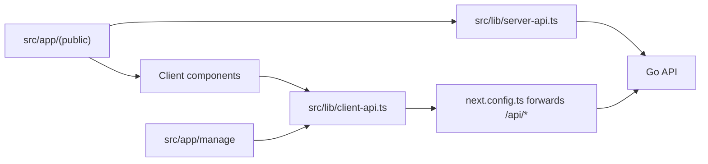

# Web

[中文](./README.md) | English

`web/` is the EcoHub Next.js front end: the public site, the login page, and the admin panel.

Stack: Next.js 16, React 19, TypeScript, Ant Design 6, Axios, Less, Artplayer, Hls.js.

## How requests reach the backend

The browser only requests `/api/*` on the same site. Next forwards it to the Go backend at `API_URL`. During server-side rendering, `src/lib/server-api.ts` calls the backend at `API_URL` directly.



Example: with `API_URL=http://127.0.0.1:8080`, the browser requests `http://127.0.0.1:3000/api/home` and Next forwards it to `http://127.0.0.1:8080/api/home`.

## Run locally

You need Node.js 20.9+, and the Go backend must be running (see [Server](../server/README_EN.md)).

```bash
cd web
cp .env.example .env.local
npm install
npm run dev
```

Contents of `.env.example`:

```env
PORT=3000
API_URL=http://127.0.0.1:8080
```

Site `http://127.0.0.1:3000`, login page `/login`, admin `/manage`.

### Run the web app in a container

The dev compose file `docker-compose.yml` in the repository root has a `web` service built from source with `web/Dockerfile`, with the container named `Eco-web`. This file is for local development only; how it differs from the release file: [Overview](../docs/README_EN.md#local-development).

```bash
docker compose up -d mysql redis
docker compose up -d --build web
```

- Run it in the repository root. `web` waits for the `server` health check to pass, so it also builds and starts `server`.
- `API_URL` is `http://server:8080` both at build time and at run time, which is the `server` service in the same compose file. It does not read `web/.env.local`.
- The site is mapped to `3000` on the host (`WEB_PORT`).

## Environment variables

| Variable | Default | Required | Notes |
| --- | --- | --- | --- |
| `PORT` | `3000` | No | Local dev port |
| `API_URL` | none | Yes | Go backend address. Build and start both fail when it is unset |

About `API_URL`:

- With or without `/api`, with or without a trailing `/`: `http://127.0.0.1:8080` and `http://127.0.0.1:8080/api/` work the same.
- If the backend is on another machine, use that machine's address.
- Restart Next after changing it. `API_URL` is written into the build output, so a production build needs `npm run build` again after a change.
- Inside a container, `127.0.0.1` means the container itself.
- The release image fixes it to `http://127.0.0.1:8080` at build time. You do not set it when deploying.

## Authentication

- The login state is the HttpOnly cookie `ecohub_auth_token` set by the backend.
- Opening `/manage` goes through two checks: `src/proxy.ts` first checks that the cookie exists and redirects to `/login` if not; `src/app/manage/layout.tsx` then requests `/api/manage/user/info` and also redirects to `/login` if the backend rejects it.
- The backend decides on the JWT, the token in Redis, and write permission. `src/lib/client-api.ts` redirects to `/login` on `401` and shows a no-permission message on `403`.

## Directory layout

```text
web/
├── src/app/(public)/    # Public site
├── src/app/login/       # Login page
├── src/app/manage/      # Admin panel
├── src/components/      # Shared components
├── src/lib/             # server-api.ts, client-api.ts, api-base.ts, and more
├── src/proxy.ts         # Cookie check for /manage
├── patches/             # Patches applied by patch-package after npm install
└── next.config.ts       # /api/* forwarding, standalone output
```

## Commands

| Command | What it does |
| --- | --- |
| `npm run dev` | Dev mode |
| `npm run build` | Production build, standalone output |
| `npm run start` | Run the production build |
| `npm run lint` | ESLint check |

## Related

[Overview](../docs/README_EN.md) · [Server](../server/README_EN.md) · [Deploy guide](../docs/README-Deploy_EN.md) · [FAQ](../docs/README-FAQ_EN.md)
